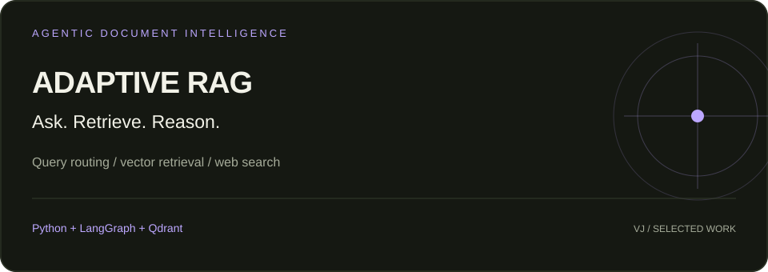
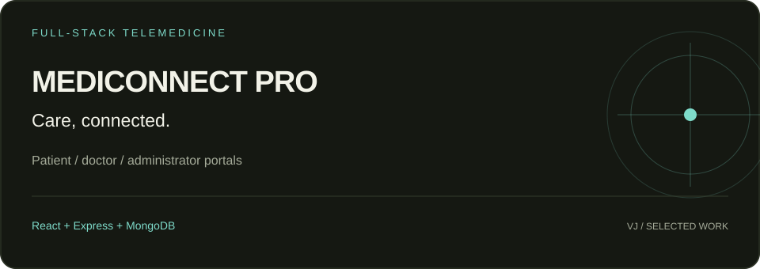
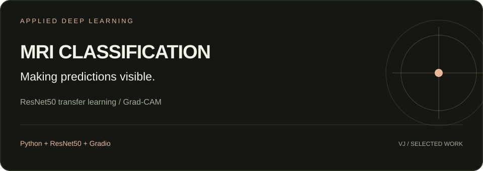

 

**[About](#about-me) · [Selected work](#selected-work) · [Technical toolkit](#technical-toolkit) · [Background](#background) · [Connect](#lets-connect)**

## About me

I'm **Vishwajeet Jaiswal**, a Computer Science graduate from **Rajkiya Engineering College, Kannauj**, based in **Kushinagar, Uttar Pradesh, India**. I build full-stack web applications and explore how machine learning, retrieval systems, and browser-based simulations can turn complex ideas into usable experiences.

My work spans a double-entry banking ledger, a telemedicine platform, an adaptive RAG chatbot, MRI classification, and an interactive 3D optics lab. I enjoy connecting the pieces: interface, API, data model, and deployment.

| What I build | What you'll find in my repositories |
| :--- | :--- |
| **Full-stack products** | React interfaces, Node.js / Express APIs, authentication, and database-backed workflows |
| **Applied AI** | Document retrieval, agentic query routing, transfer learning, and model explainability |
| **Interactive learning** | Browser-based 3D scenes, optics simulations, and hands-on exploration |

## Selected work

### 01 / Volta Banking Ledger

A digital banking learning project built around **double-entry accounting** and a React dashboard.

- **Ledger architecture:** balanced debit and credit entries, with balances derived from ledger records using MongoDB aggregation.
- **Transaction integrity:** multi-document ACID transactions, rollback on failure, and idempotency keys for transfer retries.
- **Application experience:** account creation, transfers, transaction history, JWT authentication, and email notifications.

**Stack:** React · Vite · Node.js · Express · MongoDB · JWT · Nodemailer 
**[Source code →](https://github.com/prince53454/Volta-Banking-Ledger)** · **[Open demo →](https://volta-banking-ledger.vercel.app)**

### 02 / Adaptive RAG · Agentic AI Chatbot

An end-to-end retrieval-augmented generation system that chooses how to answer each query.

- **Adaptive routing:** directs questions to uploaded documents, general knowledge, or web search.
- **Retrieval workflow:** document chunking, embeddings, Qdrant similarity search, relevance grading, and query rewriting.
- **Application layers:** LangGraph orchestration, a FastAPI backend, Streamlit document uploads, and MongoDB conversation storage.

**Stack:** Python · LangGraph · Qdrant · FastAPI · Streamlit · MongoDB 
**[Explore the architecture and code →](https://github.com/prince53454/adaptive-rag-agentic-chatbot)**

### 03 / MediConnect Pro

A telemedicine learning platform with separate **patient, doctor, and administrator portals**.

- **Role-based workflows:** dedicated interfaces for patients, doctors, and administrators with authenticated API access.
- **Pharmacy flow:** prescription uploads, stock reservations, order handling, and payment-provider integration.
- **Development and deployment:** frontend builds, backend checks, Docker support, and a Vercel deployment.

**Stack:** React · Node.js · Express · MongoDB · JWT · Docker 
**[Source code →](https://github.com/prince53454/Online-Doctor-s-consultation)** · **[Open demo →](https://mediconnect-pro-prince53454.vercel.app)**

### 04 / Alzheimer's MRI Classification

An educational deep learning project for classifying brain MRI images into four dementia stages.

- **Model:** ResNet50 transfer learning with class-weighted training to address imbalanced categories.
- **Explainability:** Grad-CAM heatmaps visualize the image regions associated with model predictions.
- **Evaluation and interface:** classification reports, confusion matrices, and a Gradio upload-and-predict application.

**Stack:** Python · ResNet50 · Grad-CAM · Gradio 
**[Source code →](https://github.com/prince53454/Alzheimer-s-Detection)** · **[Open demo →](https://alzheimer-s-detection-wi4c.onrender.com/)**

Educational demonstration; not a medical diagnostic tool. The hosted demo may need time to wake after inactivity.

### 05 / Opticverse 3D

A browser-based optics lab for exploring **reflection, refraction, and ray tracing**.

- **Sandbox:** place light sources, mirrors, and lenses to explore how rays behave.
- **Visualization:** interactive Three.js scenes make optical concepts visible in 3D.
- **Learning:** study content and quizzes complement the simulation tools.

**Stack:** Three.js · JavaScript · HTML · CSS · Hugging Face Spaces 
**[Source code →](https://github.com/prince53454/Opticverse-3D)** · **[Launch the lab →](https://huggingface.co/spaces/Vishu54645/opticsverse-3d)**

### 06 / Personal Portfolio

My personal home on the web: project showcases, a technical skills map, education, and contact details.

- Responsive desktop and mobile layouts, a code-editor introduction, and keyboard-accessible navigation.
- Charcoal and lime visual design, structured project cards, and direct links to repositories and demos.
- Built with vanilla HTML, CSS, and JavaScript; hosted on GitHub Pages.
 
**[Source code →](https://github.com/prince53454/Portfolio)** · **[Visit portfolio →](https://prince53454.github.io/Portfolio/Vishwajeet_Jaiswal_Portfolio.html)**

<strong>More repositories and learning</strong>

- **[AutoGen](https://github.com/prince53454/AutoGen):** repository exploring Microsoft's AutoGen ecosystem. The framework and its upstream work belong to their original authors.
- **[This profile](https://github.com/prince53454/prince53454):** the Markdown and SVG assets behind this page.
- Browse the **[full repository list](https://github.com/prince53454?tab=repositories)** for source, setup instructions, and project updates.

## Technical toolkit

| Area | Technologies and experience |
| :--- | :--- |
| **Languages** | JavaScript, Python, Java (data structures and algorithms), SQL, HTML5, CSS3 |
| **Frontend** | React, Vite, responsive layouts, form validation, Three.js |
| **Backend** | Node.js, Express, REST APIs, JWT authentication, FastAPI |
| **Data** | MongoDB, MySQL, Qdrant vector search, aggregation pipelines, database transactions |
| **AI and ML** | LangGraph, RAG, embeddings, query routing, ResNet50, Grad-CAM, supervised learning |
| **Interfaces for AI** | Streamlit, Gradio |
| **Tools and deployment** | Git, GitHub, VS Code, Docker, Vercel, Render, GitHub Pages, Hugging Face Spaces |

## Engineering interests

- **Data integrity:** how transactions, ledger models, and idempotency protect application workflows.
- **Useful AI systems:** how retrieval, routing, and relevance checks improve document-based answers.
- **Explainable predictions:** how model evaluation and visual explanations help inspect classification behavior.
- **Clear interfaces:** how responsive layouts and interactive visualizations make technical systems easier to use.

## Background

| Period | Education or experience | Details |
| :--- | :--- | :--- |
| **2022–2026** | B.Tech, Computer Science Engineering | Rajkiya Engineering College, Kannauj · CGPA **7.2** |
| **Jun–Jul 2022** | Computer Science Internship | RECK Computer Science Board · software development support, debugging, documentation, and code reviews |
| **2020** | Senior Secondary, CBSE | Zenith Convent School, Gorakhpur · **84%** |
| **2018** | Secondary School, CBSE | Netajee Defence Academy, Gorakhpur · **69%** |

**Coursework and certifications:** Java Programming · HTML · CSS · React.js · Git & GitHub. 
**Languages:** Hindi and English.

## Explore my GitHub

The repositories and contribution history are the best place to follow my work as it evolves.

**[All repositories →](https://github.com/prince53454?tab=repositories)** · **[Contribution activity →](https://github.com/prince53454?tab=overview)**

## Let's connect

Interested in a project, a technical discussion, or working together? Reach me through email.

| Channel | Link |
| :--- | :--- |
| **Email** | [jaiswalsandy68@gmail.com](mailto:jaiswalsandy68@gmail.com) |
| **Portfolio** | [Explore my work](https://prince53454.github.io/Portfolio/Vishwajeet_Jaiswal_Portfolio.html) |
| **GitHub** | [@prince53454](https://github.com/prince53454) |
| **Location** | Kushinagar, Uttar Pradesh, India |

**Thoughtful interfaces. Reliable data. Curious experiments.**

Designed by Vishwajeet Jaiswal · Built with Markdown and custom SVGs.

