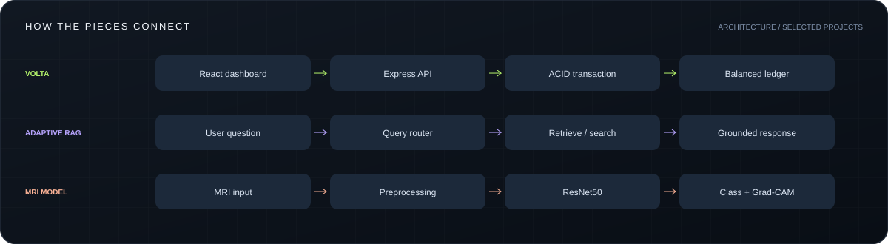

 

**[VIEW PORTFOLIO](https://prince53454.github.io/Portfolio/Vishwajeet_Jaiswal_Portfolio.html)** &nbsp; / &nbsp; **[GET IN TOUCH](mailto:jaiswalsandy68@gmail.com)** &nbsp; / &nbsp; **[EXPLORE REPOSITORIES](https://github.com/prince53454?tab=repositories)**

FULL STACK DEVELOPMENT &nbsp; / &nbsp; APPLIED AI &nbsp; / &nbsp; INTERACTIVE EXPERIENCES

## 01 / The developer

I'm **Vishwajeet**, a Computer Science graduate who enjoys building the whole system: the interface people use, the services behind it, and the data that makes it useful. Based in **Uttar Pradesh, India**.

My projects connect **React and Node.js**, **Python and AI**, and **interactive 3D on the web**. Explore the code, try the demos, or open the project notes below for the engineering details.

## 02 / Project gallery

<table>
<tr>
<td width="50%" valign="top">

<a href="https://github.com/prince53454/Volta-Banking-Ledger"><strong>Source code</strong></a> &nbsp; / &nbsp; <a href="https://volta-banking-ledger.vercel.app">Live demo</a>

</td>
<td width="50%" valign="top">

<a href="https://github.com/prince53454/adaptive-rag-agentic-chatbot"><strong>Source code</strong></a> &nbsp; / &nbsp; <a href="#04--engineering-notes">Architecture notes</a>

</td>
</tr>
<tr>
<td width="50%" valign="top">

<a href="https://github.com/prince53454/Online-Doctor-s-consultation"><strong>Source code</strong></a> &nbsp; / &nbsp; <a href="https://mediconnect-pro-prince53454.vercel.app">Live demo</a>

</td>
<td width="50%" valign="top">

<a href="https://github.com/prince53454/Alzheimer-s-Detection"><strong>Source code</strong></a> &nbsp; / &nbsp; <a href="https://alzheimer-s-detection-wi4c.onrender.com/">Live demo</a>

</td>
</tr>
<tr>
<td width="50%" valign="top">

<a href="https://github.com/prince53454/Opticverse-3D"><strong>Source code</strong></a> &nbsp; / &nbsp; <a href="https://huggingface.co/spaces/Vishu54645/opticsverse-3d">Launch lab</a>

</td>
<td width="50%" valign="top">

<a href="https://github.com/prince53454/Portfolio"><strong>Source code</strong></a> &nbsp; / &nbsp; <a href="https://prince53454.github.io/Portfolio/Vishwajeet_Jaiswal_Portfolio.html">Visit website</a>

</td>
</tr>
</table>

The MRI classifier is an educational project, not a medical diagnostic tool. Hosted demos may need time to wake after inactivity.

## 03 / Behind the interface

| Layer | My toolkit |
| :--- | :--- |
| **Interface** | React, Vite, HTML5, CSS3, JavaScript, Three.js |
| **Services** | Node.js, Express, REST APIs, JWT, FastAPI |
| **Data** | MongoDB, MySQL, Qdrant, aggregation pipelines, ACID transactions |
| **Intelligence** | Python, LangGraph, RAG, ResNet50, Grad-CAM, Streamlit, Gradio |
| **Delivery** | Git, GitHub, Docker, Vercel, Render, GitHub Pages, Hugging Face Spaces |
| **Foundations** | Java, data structures and algorithms, SQL, model evaluation |

## 04 / Engineering notes

**Open a project to explore its features and technical choices.**

<strong>Volta Banking Ledger</strong>

A digital banking learning project built around **double-entry accounting** and a React dashboard.

- **Ledger architecture:** balanced debit and credit entries, with balances derived from ledger records using MongoDB aggregation.
- **Transaction integrity:** multi-document ACID transactions, rollback on failure, and idempotency keys for transfer retries.
- **Application experience:** account creation, transfers, transaction history, JWT authentication, and email notifications.

**Stack:** React · Vite · Node.js · Express · MongoDB · JWT · Nodemailer 
**[Source code →](https://github.com/prince53454/Volta-Banking-Ledger)** · **[Open demo →](https://volta-banking-ledger.vercel.app)**

<strong>Adaptive RAG · Agentic AI Chatbot</strong>

An end-to-end retrieval-augmented generation system that chooses how to answer each query.

- **Adaptive routing:** directs questions to uploaded documents, general knowledge, or web search.
- **Retrieval workflow:** document chunking, embeddings, Qdrant similarity search, relevance grading, and query rewriting.
- **Application layers:** LangGraph orchestration, a FastAPI backend, Streamlit document uploads, and MongoDB conversation storage.

**Stack:** Python · LangGraph · Qdrant · FastAPI · Streamlit · MongoDB 
**[Explore the architecture and code →](https://github.com/prince53454/adaptive-rag-agentic-chatbot)**

<strong>MediConnect Pro</strong>

A telemedicine learning platform with separate **patient, doctor, and administrator portals**.

- **Role-based workflows:** dedicated interfaces for patients, doctors, and administrators with authenticated API access.
- **Pharmacy flow:** prescription uploads, stock reservations, order handling, and payment-provider integration.
- **Development and deployment:** frontend builds, backend checks, Docker support, and a Vercel deployment.

**Stack:** React · Node.js · Express · MongoDB · JWT · Docker 
**[Source code →](https://github.com/prince53454/Online-Doctor-s-consultation)** · **[Open demo →](https://mediconnect-pro-prince53454.vercel.app)**

<strong>Alzheimer's MRI Classification</strong>

An educational deep learning project for classifying brain MRI images into four dementia stages.

- **Model:** ResNet50 transfer learning with class-weighted training to address imbalanced categories.
- **Explainability:** Grad-CAM heatmaps visualize the image regions associated with model predictions.
- **Evaluation and interface:** classification reports, confusion matrices, and a Gradio upload-and-predict application.

**Stack:** Python · ResNet50 · Grad-CAM · Gradio 
**[Source code →](https://github.com/prince53454/Alzheimer-s-Detection)** · **[Open demo →](https://alzheimer-s-detection-wi4c.onrender.com/)**

Educational demonstration; not a medical diagnostic tool. The hosted demo may need time to wake after inactivity.

<strong>Opticverse 3D</strong>

A browser-based optics lab for exploring **reflection, refraction, and ray tracing**.

- **Sandbox:** place light sources, mirrors, and lenses to explore how rays behave.
- **Visualization:** interactive Three.js scenes make optical concepts visible in 3D.
- **Learning:** study content and quizzes complement the simulation tools.

**Stack:** Three.js · JavaScript · HTML · CSS · Hugging Face Spaces 
**[Source code →](https://github.com/prince53454/Opticverse-3D)** · **[Launch the lab →](https://huggingface.co/spaces/Vishu54645/opticsverse-3d)**

<strong>Personal Portfolio</strong>

My personal home on the web: project showcases, a technical skills map, education, and contact details.

- Responsive desktop and mobile layouts, a code-editor introduction, and keyboard-accessible navigation.
- Charcoal and lime visual design, structured project cards, and direct links to repositories and demos.
- Built with vanilla HTML, CSS, and JavaScript; hosted on GitHub Pages.
 
**[Source code →](https://github.com/prince53454/Portfolio)** · **[Visit portfolio →](https://prince53454.github.io/Portfolio/Vishwajeet_Jaiswal_Portfolio.html)**

## 05 / Background

| Period | Milestone |
| :--- | :--- |
| **2022 - 2026** | **B.Tech, Computer Science Engineering** / Rajkiya Engineering College, Kannauj / CGPA 7.2 |
| **Jun - Jul 2022** | **Computer Science Internship** / RECK Computer Science Board / development support, debugging, documentation, and code reviews |
| **2020** | **Senior Secondary, CBSE** / Zenith Convent School, Gorakhpur / 84% |
| **2018** | **Secondary School, CBSE** / Netajee Defence Academy, Gorakhpur / 69% |

<strong>Certifications, languages, and other repositories</strong>

**Coursework and certifications:** Java Programming, HTML, CSS, React.js, Git & GitHub.

**Languages:** Hindi and English.

**[AutoGen](https://github.com/prince53454/AutoGen):** exploring the AutoGen ecosystem; the framework and upstream work belong to their original authors.

**[Profile source](https://github.com/prince53454/prince53454):** the Markdown, SVG illustrations, and setup notes behind this page.

## 06 / Start a conversation

A project idea, an engineering question, or a chance to work together? **[Send me an email](mailto:jaiswalsandy68@gmail.com).**

**[Portfolio](https://prince53454.github.io/Portfolio/Vishwajeet_Jaiswal_Portfolio.html)** &nbsp; / &nbsp; **[jaiswalsandy68@gmail.com](mailto:jaiswalsandy68@gmail.com)** &nbsp; / &nbsp; **[GitHub activity](https://github.com/prince53454?tab=overview)**

DESIGNED BY VISHWAJEET JAISWAL / CUSTOM SVG + MARKDOWN / ALWAYS BUILDING

